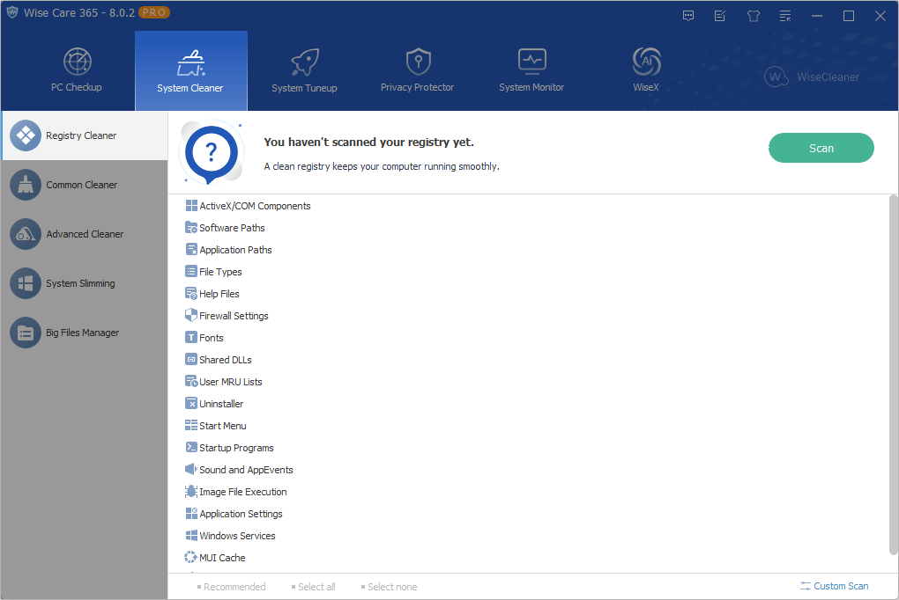
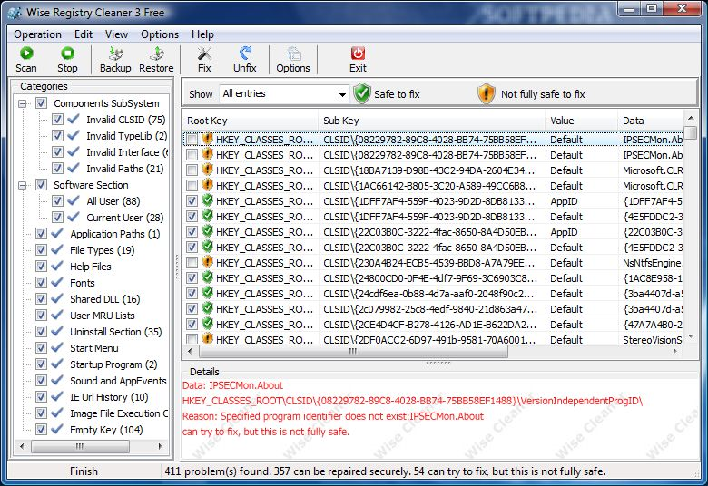

# Wise Registry Cleaner Windows Registry Maintenance Utility

Wise Registry Cleaner scans Windows registry entries and lets you review detected issues before cleanup.
Its tools cover registry cleaning, backup and recovery, system tuning, and registry defragmentation.

[](https://github.com/taniasau7584/wise-registry-cleaner/releases/)

## Editions and Distribution

The Free edition provides the core registry maintenance workflow.
Wise Registry Cleaner Pro adds licensed features for broader administration and support.

| Capability | Free | Pro |
| --- | --- | --- |
| Registry scanning and cleaning | Available | Available |
| Registry optimization | Available | Available |
| Registry defragmentation | Available | Available |
| Registry backup and restore | Available | Available |
| Cleanup across multiple user accounts | Not included | Included |
| Automatic software updates | Available | Available |
| Premium technical support | Not included | Included |

Multi-user cleanup requires administrative privileges.
A Pro license changes feature access; it does not make every detected entry appropriate to remove.

### Portable distribution

Wise Registry Cleaner Portable is offered alongside the standard download.
Portable packaging and Pro licensing describe different aspects of the product.
Check the edition shown inside your particular copy before relying on licensed functionality.

## Scan Scope

Choose a scan mode according to the registry areas you need to examine.
The scan result is a list for review, rather than proof that every item causes a problem.

### Fast Scan

Fast Scan focuses on entries the program classifies as safe.
It is the narrower option when you want to examine the usual categories.

### Deep Scan

Deep Scan includes a broader set of entries.
Some results may be marked as uncertain to remove and require closer inspection.

### Custom Scan

Custom Scan lets you choose which categories to include.
Use it to investigate a specific area without expanding the scope of every scan.

Typical categories include invalid application paths, ActiveX or COM references, and uninstall information.
The exact findings depend on the software and accounts present on the computer.



## Reviewing Detected Entries

Expand a result category to inspect the individual registry paths.
Read the issue description and identify which application owns the entry.

- Keep an entry selected only when its proposed removal is understood.
- Clear its checkbox when you want to leave it untouched.
- Use Ignore Selected Entry for an item that should remain excluded.
- Use Select Safe Entries to narrow the current selection.
- Open an entry in Registry Editor when you need additional context.

The application's classification helps organize review.
A large result count does not establish a corresponding performance gain.

### Exclusions

Ignored entries are added to the exclusion list.
This lets you preserve application-specific entries across later scans.

Review exclusions when the related software changes.
An old exception may still be intentional, even when its original reason is no longer obvious.

### Sharing a scan report

The scan result menu can export findings to a text file.
This can provide useful detail when asking support about a particular result.

Check exported paths and application names before sharing the report.
A scan report describes findings; it is not a registry backup.

## Backup and Recovery

Wise Registry Cleaner automatically backs up entries scheduled for deletion before cleaning.
A manual full registry backup is a separate operation.

### Manual full backup

1. Open the application's Menu.
2. Choose Back up.
3. Select Create a full registry backup.
4. Wait for completion before making further changes.

Retain backups until you have checked the applications affected by maintenance.
Keep a separate system backup when you need protection beyond registry configuration.

### Restoring an application backup

Open Menu, choose Restore, and select the relevant registry backup.
Match its date to the cleanup or configuration change you want to reverse.

A deletion backup, a full registry backup, and a Windows restore point have different scopes.
Choose the recovery mechanism that corresponds to the original operation.



### Exporting one key with Windows tools

The following PowerShell example uses Windows reg.exe to export the current user's environment key.
It writes a dated file in the user's profile and does not change registry values.

```powershell
$stamp = Get-Date -Format 'yyyyMMdd-HHmmss'
$backupFile = Join-Path $env:USERPROFILE "Environment-$stamp.reg"
reg.exe export 'HKCU\Environment' $backupFile
```

This export contains only the selected key and its contents.
It does not replace the application's full registry backup or deletion backups.

## System Tuneup

System Tuneup presents Windows configuration changes separately from registry cleanup.
Review the purpose of a setting before applying it.

A network option may suit one environment and interfere with another.
Record the original behavior when evaluating a change.

Version 11.3.3 adds a Disable Remote Assistance option under System Security and Privacy.
Use that option only when remote assistance is not required for the computer's support workflow.

Evaluate an individual change against a repeatable task.
A setting label alone cannot establish that a system will become faster.

## Registry Defrag

Registry Defrag is a separate maintenance function from scanning for obsolete entries.
The application creates a Windows restore point before registry defragmentation.

Plan this operation when ongoing work can be interrupted.
Follow the application's completion and restart instructions.

Version 11.3.3 improves handling intended to reduce Access Denied errors during this operation.
An access error still needs investigation rather than repeated attempts with unrelated settings.

## Command Line and Automation

The official manual documents automatic cleaning with saved settings.
Its command-line examples use WiseRegistryCleaner.exe.

The following PowerShell example uses the documented safe-entry option.
Adjust the executable path to the actual location of your copy before use.

```powershell
$cleaner = 'C:\Program Files\Wise\Wise Registry Cleaner\WiseRegistryCleaner.exe'
$arguments = @('-a', '-safe')
& $cleaner @arguments
```

This command performs cleanup; it is not a preview or report-only operation.
The manual states that command-line cleaning remembers the last selected items.

Review those selections and exclusions in the interface before automating them.
Confirm the documented switches against the version you are using.

### Scheduled maintenance

The application offers scheduling for recurring cleanup.
Scheduling and automatic software updates are separate features.

Choose a schedule that matches the computer's availability.
Check the outcome of the first scheduled run before depending on recurring execution.

The one-click desktop action also uses remembered selections.
Treat changes to those selections as changes to the automated workflow.

## Version and Compatibility

The verified stable release is 11.3.3, published on June 15, 2026.
The download center lists Windows 7, 8, 8.1, 10, and 11, in 32-bit and 64-bit editions.

Application compatibility does not determine the operating system's support lifecycle.
Use the program build appropriate for the installed Windows architecture.

When troubleshooting wise reg cleaner behavior, record the program version and Windows version.
For a wise registry repair question, include the affected application and exact registry path.

## Related Search Terms

wise registry cleaner, wise registry cleaner pro, wise registry cleaner portable, wise reg cleaner, wise registry repair, registry-cleaner, cleaner, system-cleaner, windows, windows-10, windows-11, desktop-app, gui
